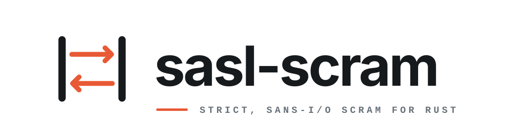

<p align="center">
  
</p>

<p align="center">
  <strong>Strict, sans-I/O SCRAM for Rust.</strong>
</p>

<p align="center">
  Client/server state machines with exact transcripts, proofs, channel binding, and zeroization.
</p>

<p align="center">
  <a href="#install">Install</a>
  <span> · </span>
  <a href="#model">Model</a>
  <span> · </span>
  <a href="#client">Client</a>
  <span> · </span>
  <a href="#server">Server</a>
  <span> · </span>
  <a href="#mechanisms">Mechanisms</a>
  <span> · </span>
  <a href="#qualification">Qualification</a>
</p>

<br />

## Status

`sasl-scram` is pre-alpha. Version `0.0.1-rc.3` implements the SHA-256 client and
server roles, including channel binding. SHA-512 is available as an opt-in
extension profile.

Hosted interoperability and supported-release qualification are not complete.
Do not yet treat this version as a supported authentication dependency.

## Install

```toml
[dependencies]
sasl-scram = "0.0.1-rc.3"
```

Rust 1.88+ with required `alloc`; `std` is optional and enabled by default.

## Model

```text
application  framing, transport, TLS, deadlines, storage, authorization
                                  │ opaque messages
                                  ▼
sasl-scram   parsing, transcripts, state, proofs, policy, secret ownership
```

The crate performs no I/O. Callers own transport, TLS, credential lookup,
authorization, retries, and scheduling. Consuming state transitions make each
conversation explicit, while bounded parsers retain the exact authenticated
wire fragments.

## Client

Proof derivation is an explicit step, so async callers can move it to a
blocking pool:

```rust
let credentials = sasl_scram::AsciiProfile::prepare(
    "user",
    sasl_scram::SecretString::new("pencil"),
)?;
let config = sasl_scram::ClientConfig::builder(sasl_scram::Algorithm::Sha256)
    .credentials(credentials)
    .channel_binding(sasl_scram::ChannelBindingMode::Unsupported)
    .build()?;

let (client, first) = sasl_scram::Client::start(config, &mut nonce_source)?;
transport.send(first.as_bytes())?;
let pending = client.receive_server_first(&server_first)?;
let (client, final_message) = pending.derive()?;
transport.send(final_message.as_bytes())?;
let authenticated = client.receive_server_final(&server_final)?;
```

Authentication succeeds only after constant-time verification of the server
signature over the exact transcript.

Every client configuration must explicitly select `Unsupported`,
`AvailableButNotNegotiated`, or `Required`; omission returns
`MissingChannelBindingMode`.

`PreparedCredentials` is consumed by one conversation and intentionally is not
`Clone`. A reconnect factory should retain normalized credential material in
caller-owned zeroizing storage, construct fresh credentials per connection,
and select channel binding from that connection's TLS session.

## Server

Credential lookup and authorization are caller-owned continuations. Received
identities must be prepared before lookup, and a verified proof still requires
an explicit authorization decision before it becomes an application principal.

Unknown identities can use deterministic synthetic credentials with a
deployment-owned concealment key. Concealed and invalid-proof paths return the
same terminal error, and concealed users can never produce a principal.

## Mechanisms

| Mechanism | Feature | Availability |
| --- | --- | --- |
| `SCRAM-SHA-256` | `sha256` | Default |
| `SCRAM-SHA-256-PLUS` | `sha256` | Default; caller-supplied channel binding |
| `SCRAM-SHA-512` | `sha512` | Opt-in extension profile |
| `SCRAM-SHA-512-PLUS` | `sha512` | Opt-in extension with channel binding |

Configuration always requires an explicit `Algorithm`; features never select
a mechanism implicitly. PLUS authenticates binding bytes supplied by the
caller from the live TLS connection. The crate never calls a TLS API.

The optional `saslprep` feature provides RFC 5802 query and stored-string
preparation. ASCII preparation remains available for protocols with an
ASCII-only identity contract.

## Security

- Inbound authenticated fragments remain byte-exact.
- Outbound messages are canonical, bounded, and redacted.
- Owned secrets, bindings, proofs, and transcripts zeroize on drop.
- Proof work is explicit and subject to caller-configured limits.
- Proofs, signatures, and channel-binding values use constant-time comparison.
- Malformed input, unsupported mandatory extensions, downgrade attempts, and
  policy violations fail closed.

The public API exposes no sockets, async runtime, TLS implementation,
credential database, secret serialization, or bring-your-own-crypto trait.

## Supported-release boundary

The current release candidate does not make a stable-release promise. A future
supported line must preserve its public source API, exact-transcript and secret
ownership contracts, and Rust 1.88 MSRV across patch releases. Breaking changes
require an explicitly announced new compatibility line.

The Kafka-used promotion target is the client role with `std`, `sha256`,
`sha512`, and `saslprep`, without PLUS. Supported mechanism, role, preparation,
and channel-binding claims require their own applicable qualification. Kafka
client evidence does not establish hosted server-role or PLUS interoperability;
the fixed PostgreSQL-style transcript fixture is not a hosted PostgreSQL run.

## Reference applications

```sh
cargo run --example scram-sha256-client --locked --offline
cargo run --example continuation-server --locked --offline
cargo run --example scram-sha512-plus --no-default-features --features std,sha512 --locked --offline
```

The examples use only the public API. They perform no socket I/O and print no
credential or protocol material.

## Qualification

```sh
zcheck
```

`zcheck` is the canonical repository gate. It checks architecture, formatting,
strict Clippy, the feature and `no_std + alloc` matrices, tests, examples, fuzz
targets, rustdoc, dependency policy, package contents, and the zrail lock.

## Scope

`sasl-scram` owns SCRAM protocol mechanics—not transport security, credentials,
authorization policy, scheduling, retries, or observability.

## License

Apache-2.0. See [LICENSE](LICENSE).
